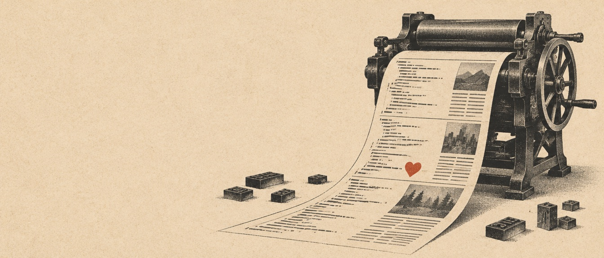
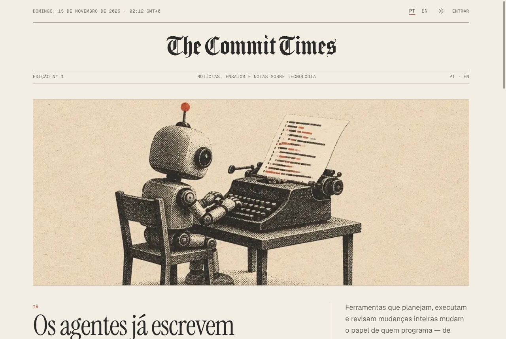
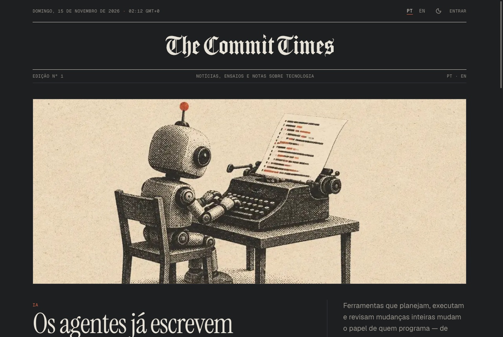

<div align="center">


**Notícias, ensaios e notas sobre tecnologia — impressos com carinho.**

<sub>Um blog pessoal em formato de jornal: minimalista, bilíngue (PT · EN) e escrito à mão.</sub>

<br />


</div>



---

## Edição de hoje

<table>
  <tr>
    <td width="50%"></td>
    <td width="50%"></td>
  </tr>
  <tr>
    <td align="center"><sub>Tema claro — papel bege</sub></td>
    <td align="center"><sub>Tema escuro — grafite, não preto</sub></td>
  </tr>
</table>


## O que tem dentro

| | |
|---|---|
| 📰 **Layout de jornal** | Cabeçalho com data, hora e edição; manchete, grade de matérias, capitular, filetes finos. Paleta 60/30/10: papel, tinta e um único vermelho editorial. |
| 🌗 **Claro e escuro** | Troca de tema que **rasga a página** do canto superior direito ao inferior esquerdo (View Transitions API), com fallback instantâneo para quem prefere menos movimento. |
| 🌍 **Bilíngue** | Português em `/`, inglês em `/en` (next-intl). Cada post tem slug próprio por idioma; um artigo sem tradução aparece no original com aviso e `canonical`. |
| ✍️ **Escrita** | Markdown renderizado no servidor (unified + Shiki com tema duplo), sem HTML cru e sem JavaScript extra no cliente. |
| 💬 **Leitores** | Contas opcionais para curtir e comentar (respostas em um nível), perfil com foto, troca de senha, "sair de todos os dispositivos" e exclusão de conta que preserva respostas de outras pessoas. |
| 🗞️ **Sala de redação** | Painel admin com editor PT/EN e pré-visualização, upload de capa, tags, moderação, gestão de usuários, páginas legais e disparo da newsletter. |
| ✉️ **Newsletter** | Inscrição com double opt-in, e-mails no idioma do leitor, link de cancelamento, envio que nunca repete a mesma edição. |
| 🛡️ **Segurança** | bcrypt, Zod em todas as fronteiras, limite de tentativas em login e cadastro (sem permitir que alguém trave a conta alheia), sessões invalidáveis, proteção contra open redirect, checagem de tipo real dos uploads. |
| 🍪 **Privacidade** | Só cookies essenciais, aviso de consentimento, sem analytics nem rastreamento. |
| 🎨 **Arte própria** | Logo, favicon e todas as ilustrações gerados no Higgsfield num mesmo estilo: meio-tom de risografia, tinta grafite e um detalhe vermelho. |

## Stack

- **Next.js 16** (App Router, Server Components, Server Actions) · **React 19** · **TypeScript**
- **Prisma 6** + **PostgreSQL** (Neon)
- **Auth.js v5** (credenciais, JWT com versão de sessão)
- **Tailwind CSS 4** + shadcn/ui · **Instrument Serif**, **Geist** e **Geist Mono**
- **next-intl** · **Lenis** (scroll suave) · **Zod** · **Resend** · **Shiki**

## Rodando localmente

```bash
git clone https://github.com/FelipeKreulich/felipe-blog.git
cd felipe-blog
npm install
cp .env.example .env        # preencha as variáveis abaixo
npx prisma migrate deploy   # cria as tabelas
npm run admin:create -- voce@email.com   # sua conta de admin (a senha é pedida no terminal)
npm run content:publish     # publica os artigos e as páginas legais de content/
npm run dev
```

Abra [http://localhost:3000](http://localhost:3000).

### Variáveis de ambiente

| Variável | Para quê |
|---|---|
| `DATABASE_URL` | Conexão PostgreSQL |
| `NEXTAUTH_SECRET` | Segredo das sessões (`openssl rand -base64 32`) |
| `NEXTAUTH_URL` / `NEXT_PUBLIC_APP_URL` | URL pública do site |
| `RESEND_API_KEY` | Envio de e-mails |
| `FROM_EMAIL` | Remetente (domínio verificado no Resend) |

## Scripts

| Comando | O que faz |
|---|---|
| `npm run dev` | Servidor de desenvolvimento |
| `npm run build` / `npm start` | Build e servidor de produção |
| `npm run admin:create -- email` | Cria ou promove a conta de admin |
| `npm run content:publish` | Publica `content/` no banco (só cria o que falta) |
| `npm run content:publish -- --update` | Regrava os posts a partir dos arquivos |

## Conteúdo como código

Os artigos iniciais vivem em [`content/posts`](content/posts), tipados por [`content/types.ts`](content/types.ts), com as capas em [`public/covers`](public/covers). O script de publicação é idempotente e seguro para produção: cria o que não existe e não sobrescreve o que foi editado no admin (a menos que se use `--update`). Depois de publicado, o dia a dia acontece no painel em `/admin`.

## Estrutura

```
app/[locale]/        páginas públicas, perfil, auth e /admin (sala de redação)
components/          site, post, perfil, auth e admin
content/             artigos, tags e textos legais versionados
lib/                 ações de servidor, auth, markdown, rate limit, utilidades
prisma/              schema e migrations
scripts/             create-admin, publish-content
public/              logo, favicon, capas e ilustrações
```

---

<div align="center">
<sub>Feito com ♥ por <a href="https://github.com/FelipeKreulich">Felipe Kreulich</a> · <a href="https://buymeacoffee.com/felipekreulich">me pague um café</a></sub>
</div>
